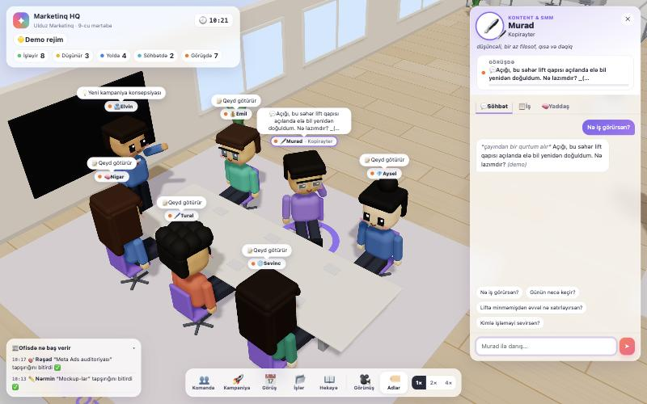

# ✦ Marketinq HQ: a 3D office where live agents work

> **Ulduz Marketing, 9th floor.** 24 people work here. You watch them from above, walk up to anyone and talk, hand out tasks.
> They don't think of themselves as bots. As far as they know, this office is their life.



**[Azərbaycan dilində →](README.md)**

Marketinq HQ is a 3D office simulation that runs in the browser. Every character is a real language-model agent with its own personality, memory and profession: the copywriter writes slogans, the media buyer builds audiences, the analyst writes reports. Start a campaign and 13 of them pass the work along, one to the next.

Built with Three.js, a small Node.js server, the [Claude Code](https://docs.anthropic.com/en/docs/claude-code) CLI, and [Ruflo](https://github.com/ruvnet/ruflo) for memory. No build step.

The in-game UI and characters speak **Azerbaijani**. Translations are welcome (see [CONTRIBUTING.md](CONTRIBUTING.md)).

## The story: the Blue Lift

Every morning the **Blue Lift** opens its doors and everyone is already at their desk.

When the lift goes up, life outside stays downstairs: home, family, last night. None of it reaches the 9th floor. What happens in the office stays: yesterday's task, a chat with the Boss, who handed what to whom during a campaign.

The characters don't find this strange. Ask about the outside and they'll be honestly puzzled and curious, but they won't invent memories. They never call themselves a bot, a program or code. To them, you are the **Boss** ("Rəhbər").

The whole story and a guide are also inside the game: the **📖 Hekayə** (Story) button in the dock.

## What you can do

- **Watch:** orbit, zoom and pan around the office. Characters work, think, visit each other's desks, grab coffee and gather for meetings.
- **Talk:** move close to someone and a **💬 Danış** (Talk) prompt appears (or press `Enter`). They turn to you, wave and answer in character.
- **Assign tasks:** the **İş** (Work) tab on a character's card. The task goes to a real agent; its text streams into the speech bubble, and a **📄** link appears when it's done.
- **Run a campaign:** type a name and 13 people work in sequence: brief, insight, concept, slogans, key visual, adaptations, animation, jingle, captions, content plan, Meta Ads, Google Ads, report.
- **Memory:** each character remembers what happened in the office. What you discussed yesterday can come up today.
- **Outputs:** every result is saved as Markdown in `outputs/`.

## Quick start

Requirements: **Node.js 20+** and the **[Claude Code CLI](https://docs.anthropic.com/en/docs/claude-code)** (for live mode).

```bash
git clone https://github.com/samigiman/marketinq-ofisi.git
cd marketinq-ofisi
npm install
claude auth login   # once; Claude subscription or API key
npm start           # http://localhost:5180
```

Without Claude, use demo mode with sample answers: `npm run demo`.

| Variable | Default | Purpose |
|---|---|---|
| `PORT` | `5180` | Server port |
| `MODEL` | `sonnet` | Model for tasks and campaigns |
| `CHAT_MODEL` | `haiku` | Model for chat (fast, cheap) |
| `MAX_PARALLEL` | `3` | Concurrent Claude processes |
| `MOCK` | | `1` = never call Claude |

**Modes** (top-left badge): 🟢 Live Claude · 🟡 Demo (server up, no Claude) · ⚪ Simulation (no server).
Animation, walking, idle chatter and meetings **never** call a model. Tokens are used only when you chat, assign a task or start a campaign.

## How it works

1. The browser renders the office. Everyday life (work, breaks, small talk, meetings) runs entirely client-side.
2. When you talk, the server builds the character's system prompt: world rules (the lift, the Boss, "you're not a bot"), personality, colleagues, current activity, and memories recalled from Ruflo.
3. `claude -p` runs with **no tools**, and the reply streams back into the speech bubble.
4. After a chat or a task, a short memory is written to Ruflo.
5. In a campaign, each step's output is added to the next agent's prompt; the browser animates the hand-off.

Details: [docs/ARCHITECTURE.md](docs/ARCHITECTURE.md)

## Memory and Ruflo

Memories live in [Ruflo](https://github.com/ruvnet/ruflo)'s AgentDB (vector search), one namespace per character (`ofis-<id>`), with a JSONL backup in `yaddas/`. Delete `yaddas/` to send the office back to "day one".

> ℹ️ Ruflo reads Claude Code environment variables such as `CLAUDE_PROJECT_DIR`. So that memory never mixes with another project even when the server is started from inside Claude Code, Ruflo runs only inside `yaddas/` with those variables stripped. This project uses Ruflo for memory only; `ruflo init` isn't needed. See [docs/RUFLO.md](docs/RUFLO.md).

## Security

- Agents run with `claude -p --tools ""`: no file access, no shell, no web, no ad accounts. Text only.
- No user hooks, plugins or MCP servers are loaded. The working directory is empty.
- The server listens on `127.0.0.1` only.
- `outputs/` and `yaddas/` are git-ignored.

Report vulnerabilities via [SECURITY.md](SECURITY.md).

## Customize

- `company.md`: your company, audience, tone and channels. The whole team will know it.
- `public/team.js`: `TEAM` (roles, skills, looks), `PERSONAS` (personality), `PIPE` (campaign steps), `WORLD` (company, floor, lift).
- `public/book.js`: the in-game story chapters.

## Limitations

- Design, video and music characters don't produce files; they write briefs, scripts and structures.
- Dashboard numbers on the wall are placeholders.
- Live mode uses your Claude account. One campaign is 13 calls.

## Contributing

New characters, rooms, animations, real data integrations and translations are all welcome. Read [CONTRIBUTING.md](CONTRIBUTING.md) first.

## License

[MIT](LICENSE)
