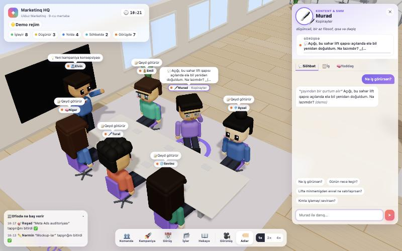

# ✦ Marketinq HQ: canlı agentlərin yaşadığı 3D ofis

> **Ulduz Marketinq**, Bakıda kiçik reklam agentliyi. Burada 24 nəfər işləyir, siz isə onun rəhbərisiniz.
> Yaxınlaşıb danışırsınız, tapşırıq verirsiniz. Hər birinin öz həyatı, öz fikri və öz danışıq tərzi var.



**[English version →](README.en.md)**

Marketinq HQ brauzerdə işləyən 3D ofis simulyasiyasıdır. İçindəki hər personaj real dil modeli agentidir: öz xarakteri, öz yaddaşı və öz peşəsi var. Kopirayter sloqan yazır, tarqetoloq auditoriya qurur, analitik hesabat çıxarır. Bir kampaniya başladanda 13 nəfər işi növbə ilə bir-birinə təhvil verir.

Layihə Three.js, kiçik Node.js server, [Claude Code](https://docs.anthropic.com/en/docs/claude-code) CLI və yaddaş üçün [Ruflo](https://github.com/ruvnet/ruflo) üzərində qurulub. Heç bir build addımı yoxdur.

---

## Mündəricat

- [Hekayə](#hekayə)
- [Nə edə bilərsiniz](#nə-edə-bilərsiniz)
- [Tez başlanğıc](#tez-başlanğıc)
- [Rejimlər](#rejimlər)
- [Komanda](#komanda)
- [Necə işləyir](#necə-işləyir)
- [Yaddaş və Ruflo](#yaddaş-və-ruflo)
- [Təhlükəsizlik](#təhlükəsizlik)
- [Fərdiləşdirmə](#fərdiləşdirmə)
- [Layihə strukturu](#layihə-strukturu)
- [Hüdudlar](#hüdudlar)
- [Töhfə vermək](#töhfə-vermək)
- [Lisenziya](#lisenziya)

---

## Hekayə

Ulduz Marketinqi siz (**Rəhbər**) 2018-ci ildə iki otaqda açmısınız. İndi agentlik Fəvvarələr meydanının yaxınlığında köhnə binanın 3-cü mərtəbəsindədir və 24 nəfər işləyir.

Hər personajın öz tarixi var: Murad bağlanan qəzetdən gəlib və roman yazır, Nərmin Mingəçevirdən təzə gəlib və hamıya "siz" deyir, Zaur Statistika Komitəsindən gəlib və mənbəsiz rəqəmə inanmır. İş haqqında fikirləri var və zəif ideyaya "bəli" demirlər. Kimin kimlə dost olduğu, kimin kimlə mübahisə etdiyi söhbətlərdə görünür. Gördükləri iş və sizinlə söhbətlər yaddaşlarında qalır.

Qaydalar: [docs/WORLD.md](docs/WORLD.md).

Bütün hekayə və bələdçi oyunun içində də var: aşağıdakı paneldə **📖 Hekayə** düyməsi.

## Nə edə bilərsiniz

| | |
|---|---|
| 🎥 **İzləmək** | Ofisi istənilən bucaqdan görün: fırladın, yaxınlaşın, hərəkət edin. Personajlar işləyir, düşünür, bir-birinə sual verir, qəhvə içir, görüşə toplaşır. |
| 💬 **Danışmaq** | Kiminsə yanına yaxınlaşın, **💬 Danış** düyməsi çıxır (`Enter`). Personaj sizə dönür, əl yelləyir və öz xarakterində cavab verir. |
| 📋 **Tapşırıq vermək** | Personajın kartında **İş** bölməsi. Tapşırıq real agentə gedir; yazdığı mətn nitq balonunda axır, hazır olanda **📄 bax** linki çıxır. |
| 🚀 **Kampaniya** | Bir ad yazın, 13 nəfər növbə ilə işləsin: brif, insight, konsepsiya, sloqan, vizual, animasiya, jingle, caption, kontent plan, Meta, Google, hesabat. |
| 🧠 **Yaddaş** | Hər personaj ofisdə yaşadıqlarını xatırlayır. Dünən nə danışdığınızı bu gün yada sala bilər. |
| 📂 **Nəticələr** | Bütün işlər `outputs/` qovluğuna Markdown kimi yazılır. |

## Tez başlanğıc

Tələblər: **Node.js 20+** və **[Claude Code CLI](https://docs.anthropic.com/en/docs/claude-code)** (canlı rejim üçün).

```bash
git clone https://github.com/samigiman/marketinq-ofisi.git
cd marketinq-ofisi
npm install
```

Claude CLI-yə bir dəfə giriş edin. Claude abunəliyi və ya API açarı ilə olar:

```bash
claude auth login
```

Serveri başladın və `http://localhost:5180` ünvanını açın:

```bash
npm start
```

Claude olmadan sınamaq üçün demo rejim:

```bash
npm run demo
```

Testlər (Claude çağırılmır): `npm test`.

İctimai versiya (dijital marketinq və reklam yerləşdirmə vəzifələri olmadan): `EDITION=public npm start`.

### Ulduzgram: komandanın öz sosial şəbəkəsi

Ofisdə dokdakı **Sosial** düyməsi və ya `http://localhost:5180/sosial.html`: lent (post, şəkil, bəyənmə, şərh), Chat (Ofis qrupu, şöbə qrupları, şəxsi yazışmalar) və Hesabat (kim nə qədər vaxt keçirir).
Kim nə qədər aktivdir: xasiyyətinə (məs. SMM menecer çox, SEO az), əhvalına və iş yükünə görə. İşə götürmə, çıxarma və bitən işlər də yazdırır.
Canlı rejimdə mətnləri ucuz model yazır: `SOCIAL_MAX_PER_HOUR` (default 40) saatlıq limitdir, `SOCIAL=0` söndürür.

Telefondan və ya internetdən baxmaq (yalnız sosial şəbəkə, ofisin idarəsi bağlı qalır):

```bash
SOCIAL_PASSWORD="$(cat ~/.marketinq-sosial-sifre)" npm start
cloudflared tunnel --url http://localhost:5180
```

Açılan linkdə istifadəçi adı `rehber`, şifrə `SOCIAL_PASSWORD`-dur (uzun təsadüfi şifrə yaradın: `openssl rand -base64 33 > ~/.marketinq-sosial-sifre`). Şifrəsiz internetdən heç nə açılmır.

### Agentlərin brauzeri və iş metodikası

Tapşırıqda agentlər internetdə axtarış edir və saytları oxuyur (`WEB=0` söndürür). Kompüterinizdəki marketinq skill-ləri (`~/.claude/plugins`, və ya `SKILLS_DIR`) hər rola uyğun iş metodikası kimi əlavə olunur.

### Ortaq qovluq: Google Drive və Canva

Tapşırıq formasında "Ortaq qovluqdan material götür" işarələnəndə, agent işə başlamazdan əvvəl ayrıca axtarış Drive və Canva hesablarınızdan tapşırığa aid materialları tapır. Agent onları şirkətin ortaq qovluğundan gələn sənəd kimi alır.

- Connector-lar `claude` CLI-nin claude.ai girişindən gəlir: terminalda `claude` → `/login` → claude.ai hesabı.
- Yalnız 13 oxuma aləti icazəlidir (axtarış, oxuma, siyahı). Yaratmaq, dəyişmək, paylaşmaq, silmək `dontAsk` rejimində rədd olunur, qalan connector-lar ümumiyyətlə gizlədilir.
- Agentin özü hesablara qoşulmur. Material götürülən tapşırıqda agentin brauzeri söndürülür ki, hesablardan gələn məlumat internetə çıxmasın.
- `DOCS=0` söndürür, `DOCS_MODEL` (default `sonnet`) axtarışın modelidir. Bir axtarış təxminən 1 dəqiqə və ~$0.1 çəkir.

Seçimlər (mühit dəyişənləri):

| Dəyişən | Standart | Nə edir |
|---|---|---|
| `PORT` | `5180` | Server portu |
| `MODEL` | `sonnet` | Tapşırıq və kampaniya modeli |
| `CHAT_MODEL` | `haiku` | Söhbət modeli (sürətli, ucuz) |
| `MAX_PARALLEL` | `3` | Eyni anda neçə Claude prosesi |
| `MOCK` | | `1` olsa, Claude çağırılmır (demo) |

## Rejimlər

Yuxarı sol küncdə görünür:

- **🟢 Canlı Claude**: server işləyir, CLI-yə giriş var. Söhbət və işlər real agentlərlə gedir.
- **🟡 Demo**: server işləyir, amma Claude yoxdur. Cavablar nümunədir, test üçün.
- **⚪ Simulyasiya**: server yoxdur (səhifə başqa statik serverdən açılıb). Yalnız animasiya.

Animasiya, gəzmək, söhbət balonları və görüşlər **heç vaxt** model çağırmır və pulsuzdur. Token yalnız siz danışanda, tapşırıq verəndə və ya kampaniya başladanda xərclənir.

## Komanda

24 personaj, 5 şöbə. Hər birinin bioqrafiyası, fikirləri və danışıq tərzi `public/team.js` faylındadır.

| Şöbə | Personajlar |
|---|---|
| **Rəhbərlik & Strategiya** | Elvin (CMO), Nigar (Marketoloq), Aysel (Brend Menecer), Rauf (Layihə Meneceri), Kamran (Account Menecer) |
| **Kreativ & Dizayn** | Leyla (Art Direktor), Tural (Qrafik Dizayner), Nərmin (Junior Dizayner), Orxan (Motion), Fərid (Foto & Video), Səbinə (UI/UX) |
| **Kontent & SMM** | Günay (SMM), Aynur (SMM Kopirayter), Murad (Kopirayter), Lalə (Kontent Strateq), Cavid (Community), Ülviyyə (PR & İnfluenser) |
| **Performans & Dijital** | Rəşad (Tarqetoloq), Emil (PPC), Sevinc (Dijital), Nicat (SEO), Zaur (Data Analitik), Könül (Email & CRM) |
| **Səs studiyası** | Tofiq (Bəstəkar & Səs Dizayneri) |

## Necə işləyir

```
 Brauzer (Three.js)                    Node server (server.mjs)                 Xarici
┌──────────────────────┐   HTTP/SSE   ┌──────────────────────────┐   spawn   ┌─────────────────┐
│ 3D ofis, animasiya   │ ───────────▶ │ /api/chat  (söhbət)      │ ────────▶ │ claude -p        │
│ personaj kartı, söhbət│ ◀─────────── │ /api/task  (tapşırıq)    │           │ alətsiz, izolə   │
│ kampaniya xətti      │   axın       │ /api/campaign (13 addım) │           └─────────────────┘
│ 📖 kitab             │              │ persona + dünya qaydası  │   spawn   ┌─────────────────┐
└──────────────────────┘              │ yaddaş (memory.mjs)      │ ────────▶ │ ruflo memory     │
                                      └──────────────────────────┘           │ (AgentDB)        │
                                                                             └─────────────────┘
```

1. Brauzer ofisi çəkir. Gündəlik həyat (iş, fasilə, söhbətlər, görüşlər) tamamilə brauzerdədir.
2. Siz danışanda server personajın **sistem promptunu** qurur: personajın bioqrafiyası, fikirləri, danışıq tərzi, münasibətləri, agentliyin tarixçəsi, həmkarlar, indi nə etdiyi və Ruflo-dan gələn xatirələr.
3. Söhbətdə `claude -p` alətsiz işə salınır, cavab axınla (stream) brauzerə gəlir və nitq balonunda görünür. Tapşırıqda isə personaj öz kompüterində (sandbox qovluğu) fayl və terminalla işləyir; hər əmr və fayl monitor jurnalına düşür.
4. Söhbətdən və ya işdən sonra qısa xatirə Ruflo-ya yazılır.
5. Kampaniyada hər addımın nəticəsi növbəti agentin promptuna əlavə olunur; brauzer personajların bir-birinə işi "təhvil verməsini" animasiya edir.

Ətraflı: [docs/ARCHITECTURE.md](docs/ARCHITECTURE.md)

## Yaddaş və Ruflo

Personajların xatirələri [Ruflo](https://github.com/ruvnet/ruflo)-nun yaddaşında (AgentDB, vektor axtarışı) saxlanır:

- Hər personajın öz namespace-i var: `ofis-<id>`.
- Danışanda mövzuya uyğun xatirələr semantik axtarışla gəlir.
- Ehtiyat üçün hər xatirə `yaddas/<id>.jsonl` faylına da yazılır. Ruflo işləməsə belə son xatirələr itmir.
- Yaddaşı sıfırlamaq, yəni ofisi "ilk günə" qaytarmaq üçün `yaddas/` qovluğunu silin.
- Model: Ruflo-nun standart modeli (`all-MiniLM-L6-v2`) yalnız ingiliscədir, ona görə çoxdilli `multilingual-e5-small` (8-bit, ~118 MB) qoşulur. Server ilk işə düşəndə modeli bir dəfə Hugging Face-dən `~/.cache/ruflo/models`-ə endirir, o vaxta qədər xatirələr yalnız JSONL-ə yazılır. Azərbaycan dilində test dəstində düzgün xatirə 4/11-dən 7/11-ə qalxdı, aidiyyəti olmayan sorğuda isə artıq heç nə qaytarılmır.
- Baza köhnə modellə qurulubsa, `kohne-…` adı ilə kənara qoyulur və bütün xatirələr JSONL-dən yeni modelə yenidən yazılır. `MEMORY_MODEL=minilm` köhnə modelə qaytarır.
- Axtarış xatirənin tam mətnini qaytarır (əvvəllər ~50 simvolluq önizləmə gedirdi).

> ℹ️ Ruflo `CLAUDE_PROJECT_DIR` kimi Claude Code mühit dəyişənlərini oxuyur. Ofis serveri Claude Code-un içindən işə salınsa belə yaddaşın başqa layihəyə qarışmaması üçün Ruflo yalnız `yaddas/` qovluğunda, bu dəyişənlər olmadan işə salınır. Bu layihə Ruflo-nu yalnız yaddaş üçün işlədir, `ruflo init` lazım deyil.
> Ətraflı: [docs/RUFLO.md](docs/RUFLO.md)

## Təhlükəsizlik

- **Söhbət** alətsizdir (`claude -p --tools ""`).
- **Tapşırıq və kampaniya** personajın öz kompüterində gedir: `/Users/Shared/marketinq-ofisi/kompyuterler/<id>/` (macOS; dəyişmək üçün `PC_DIR`). Orada fayl yaradır, oxuyur və əmr işlədir. Claude sandbox-u (`--restricted` + `sandbox`) bunları bağlayır:
  - yazmaq yalnız öz qovluğunda;
  - bütün ev qovluğu (layihə faylları, `~/.ssh`, açarlar), qonşu personajların qovluqları və jurnal oxumağa bağlıdır;
  - internet bağlıdır.
- **Codex** personajları (`engine: 'codex'`) yalnız `CODEX=1` ilə Codex-də işləyir. Codex sandbox-u yazmağı qovluqla məhdudlaşdırır, amma **oxumağı yox**: ev qovluğunu görə bilər. Ona görə default olaraq onlar da Claude ilə işləyir.
- İstifadəçi hook-ları, plugin-lər və MCP serverləri yüklənmir (`--setting-sources ""`, `--strict-mcp-config`).
- Server yalnız `127.0.0.1` ünvanında dinləyir.
- `outputs/` və `yaddas/` git-ə düşmür (`.gitignore`).

Təhlükəsizlik problemi tapsanız: [SECURITY.md](SECURITY.md)

## Fərdiləşdirmə

- **Şirkətiniz:** `company.md` faylını doldurun (ad, auditoriya, ton, kanallar). Bütün komanda onu bilər.
- **Personajlar:** `public/team.js`
  - `TEAM`: ad, rol, şöbə, bacarıqlar, görünüş (dəri, saç, aksesuar).
  - `PERSONAS`: xarakter, vərdiş, sevdikləri, əhval emojisi.
  - `PIPE`: kampaniya addımları və ardıcıllığı.
  - `WORLD`: şirkət, ofis, tarixçə, Rəhbər.
- **Kitab:** `public/book.js`, oyundakı hekayə fəsilləri.

## Layihə strukturu

```
marketinq-ofisi/
├── server.mjs          # körpü server: söhbət, tapşırıq, kampaniya, SSE, statik fayllar
├── memory.mjs          # Ruflo yaddaşı + JSONL ehtiyat, izolə edilmiş mühitdə
├── company.md          # şirkət konteksti (siz doldurursunuz)
├── public/
│   ├── index.html      # səhifənin skeleti
│   ├── css/ofis.css    # interfeysin stili
│   ├── js/             # 3D ofis (kit, nav, office, agents, monitors), ssenarilər, interfeys
│   ├── team.js         # komanda, xarakterlər, dünya, kampaniya xətti
│   ├── live.js         # server əlaqəsi, nəticə pəncərəsi
│   └── book.js         # oyundaxili kitab
├── docs/               # arxitektura, Ruflo, dünya qaydaları
├── outputs/            # hazır işlər (git-ə düşmür)
└── yaddas/             # personaj xatirələri (git-ə düşmür)
```

## Hüdudlar

- Dizayn, video və musiqi personajları real fayl yaratmır; texniki tapşırıq, ssenari və struktur yazırlar.
- Divardakı dashboard rəqəmləri hələlik nümunədir.
- Brauzer tabı gizlənəndə animasiya dayanır, server isə işləməyə davam edir.
- `index.html` birbaşa fayl kimi (`file://`) açılmır; modullar server tələb edir.
- Canlı rejim sizin Claude hesabınızdan istifadə edir. Bir kampaniya 13 çağırışdır.

## Töhfə vermək

Töhfələr xoşdur: yeni personaj, yeni otaq, daha yaxşı animasiya, real data inteqrasiyası, tərcümə.
Başlamazdan əvvəl [CONTRIBUTING.md](CONTRIBUTING.md) faylını oxuyun. İdeyalar üçün [issues](../../issues) bölməsinə baxın.

## Lisenziya

[MIT](LICENSE). Three.js MIT lisenziyalıdır, Ruflo MIT lisenziyalıdır.
